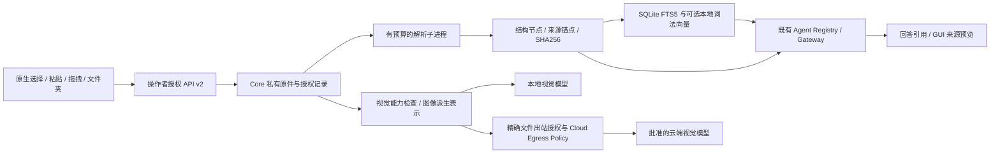

# Attachment / Document Engine v2

2026-10-25。基线：`36b6b72ba286c6a0c13b89f8f40b7b71bf0bc8aa`。独立工作树 `LocalPilot-Multimodal`，分支 `codex/multimodal-document-engine-20261025`。

## 基线审计

| 原有链路 | 审计结果 | 本轮处理 |
|---|---|---|
| GUI 选择、多文件、拖拽、粘贴 | 原生选中 ID、文件身份校验；图片缩略图与原件预览；粘贴 8 MiB 传输预算 | 保留，增加文件夹、文本预览、移除引用、粘贴缓存释放和预算 |
| v1 附件导入 | 操作者授权、SHA256、私有 provenance；原件和清单复制进工作区 | 接口原样保留；v2 原件不进入工作区 |
| Core 文件工具 | 文本读取上限 1 MB，受工作区和 Gateway 限制；不能统一解析 Office/PDF | 增加注册式文档工具；继续走同一 Registry/Gateway |
| Provider 输入 | 通用消息适配器无明确视觉能力开关 | 默认 `supports_vision=False`；明确配置且协议支持才发送图像数组 |
| Cloud Egress | `LOCAL_ONLY` / `REQUIRES_APPROVAL` / `CLOUD_ALLOWED`，字节预算和请求哈希 | 上传不授予出站；视觉增加一次性、短时、精确数据包授权 |
| 文档外部打开 | 后缀白名单调用系统应用，后缀不证明真实格式安全 | 双击仅在 Finder 显示文件，不启动附件内容 |

不修改 vLLM Router、Computer Use 或 Companion 宠物实现。TaskService 只增加默认关闭的会话初始化/资源关闭回调；既有会话无附件时不增加工具。文档扩展激活标记与会话配置指纹写入同一 Core 检查点；文档库先提交而 Core 尚未提交时，恢复仍使用旧工具 schema，并可通过幂等重试完成导入。持久化身份忽略默认关闭的视觉字段，避免无关旧会话失配；真实基线写入→新源码恢复见兼容性证据。

## 存储与表示

Core 数据目录下 `documents-v2/` 为 owner-only，保存：

- `blobs/<SHA256>`：原始字节；跨授权记录去重，不共享授权。
- `documents.sqlite3`：原名、大小、来源路径、选择来源、声明 MIME、实际格式/MIME、会话/用户、授权和期限、状态、检查点、结构节点及索引。
- `jobs/`：临时有界解析输出，正常退出/中断时释放；显式 GC 可清理崩溃遗留。

绝对来源路径仅保存在私有记录中。模型工具和云端图像数据包使用附件 ID、文件名、内容哈希及来源锚点。授权绑定 `subject + session + attachment_id`，不是共享 blob。默认授权 7 天，可在 API 选择 60 秒至 365 天的期限。任务完成后会话附件保留至撤销/到期；到期立即拒读，显式 GC 回收无有效授权的原件与索引。已经进入历史或已经发送的数据不能撤回。

Document Representation v2 的节点具有 `kind/text/anchor/properties/trust`。节点种类包括 document、page、paragraph、heading、caption、table、cell、table_region、slide、image、archive_entry、unparsed。所有内容均为 `untrusted_document_data`。

引用形如 `lpdoc:att_<id>:<序号>:<节点SHA256>`。验证同时检查当前授权、节点哈希、精确引文子串和原件 SHA256。它证明读取片段及定位，不证明模型回答正确。GUI 仅接受严格格式的本地引用，点击后重新授权读取，并核对返回节点；其余模型链接保持不可自动打开。

## 第一阶段格式边界

| 格式 | 实现 | 明确限制 |
|---|---|---|
| TXT / Markdown / 源代码 | UTF-8 行流、标题、行列与文本偏移、常见函数/类符号 | 不执行代码；其他编码不猜测；符号提取不是完整语言服务器 |
| PDF | 实际 magic、文字层、页码与段落 | 加密、无文字层、批注、图形布局等明确 unparsed；没有把 OCR 当视觉 |
| DOCX | XML 实际容器、标题样式层级、正文位置、表格单元格、图片原成员 | 自定义样式继承、页眉页脚、脚注、评论和精确排版不完整 |
| XLSX | 实际容器、工作表、单元格/合并区域、公式及存储值分别保留 | 不计算公式；缓存值标为未验证，可能陈旧；日期格式/图表/外链不求值 |
| PPTX | presentation 关系顺序、幻灯片、形状、文字/表格、几何与图片成员 | 备注、动画、图表、精确视觉布局不完整 |
| CSV | 流式单元格、行列锚点；CSV 引号由标准解析器处理 | 不执行以 `=` 开头的内容；默认逗号分隔 |
| JSON | 严格 JSON 校验、行来源 | 有整体校验字节预算；不宣称 JSONPath 结构索引 |
| PNG / JPEG / WebP | 真实头部、解码校验、像素/字节预算、色彩模式、EXIF 方向 | 原件保留；模型收到的是明确标注的派生 JPEG；不宣称原始分辨率完整进入模型 |
| ZIP | 验证中央目录并安全列出成员 | 不写出成员，不递归解压；拒绝穿越、链接、加密、重复/危险成员、膨胀和资源超限 |

Office 包检测并拒绝宏类型/VBA；不会执行宏、外部链接、嵌入程序或附件脚本。安全判定不依赖扩展名；实际 PDF 改名 `.txt` 仍检测为 PDF。

## 解析、检索与预算

子进程通过有界 NDJSON 流传递节点，Core 逐节点提交节点和 FTS 检查点。取消、服务重启后可从已提交检查点继续；当前恢复策略重放解析前缀并跳过已提交节点，不是 PDF/Office 的随机页跳转。纯文本/CSV 流式；Office 单个 XML 成员仍在成员预算内整体解析。超预算大文件不会获得无限续跑承诺。

默认宿主预算：每批 2 GiB、私有存储 8 GiB、预留磁盘 512 MiB、ZIP 总展开声明 256 MiB/成员 32 MiB/20,000 个目录条目/压缩比 200、250,000 个节点、128 MiB 提取文本、节点 2,000 字符、32M 像素、图像 24 MiB、解析子进程 RSS watchdog 512 MiB、解析和导入各 120 秒、解析输出 256 MiB。解析并发为 1；目录扫描、元数据、预览、搜索时间和向量扫描另有预算。目录条目数限制用于扫描资源保护，不是固定附件数量限制。RSS 为采样 watchdog，另有 OS CPU/输出文件限制，不宣称 OS 权限沙箱。

SQLite FTS5 为默认全文索引，辅以字面匹配覆盖中文和短语；不会引入大型数据库服务。`hybrid` 使用本地哈希词频向量、余弦排序与 RRF，属于词法向量，不是学习式语义 embedding。搜索有 3 秒、10,000 个候选向量和 4 MiB 向量文本扫描预算；截断会报告。附件目录与模型列表均分页；读取和搜索输出按字节收束，检索候选只保留有界队列，避免附件多时无界载入元数据。结果逐项含文件、页/段落/单元格/幻灯片和引用；撤销文件不会进入新检索。

## 视觉与隐私

`document_image` 只允许本地、明确支持视觉的当前模型。缺少视觉能力时明确报错；当前宿主没有 Tesseract，未实现/验证 OCR 回退，不能声称 OCR 或文件名是视觉理解。

独立云端视觉流程为 `vision_plan → vision_approve → vision_infer`。计划只展示数据包摘要、派生表示、尺寸、字节、目标模型和请求哈希；批准只允许该用户/会话下一个精确请求，120 秒失效，发送前消耗。问题、图像、顺序、目标变化都会改变哈希。`LOCAL_ONLY` 仍绝对拒绝出站；`CLOUD_ALLOWED` 也不替代文件批准。拒绝问题中已知凭据模式和常见本地绝对路径；不携带 Agent 历史或其他工具内容。日志保留操作、授权主体及视觉请求摘要，不保存图像数据包。

每个附件另行记录视觉提交和云端出站实际状态。`cloud_uploaded=false` 表示未尝试出站，成功提交后为 true，未能确认的首次失败为 null；后续失败不会抹去此前已确认披露的事实。提交成功仍标为 `completed_ungraded`，不等于视觉回答正确。

文本附件会话要求 `LOCAL_ONLY`，避免附件衍生摘要在后续自动云切换中泄露。云端文本附件对话尚未实现；不将普通聊天云授权扩大为文件授权。文档提示词不能注册工具、改变硬门、授权其他附件或批准出站。对第三方解析器漏洞的 OS 级隔离和真实模型对抗鲁棒性，本轮不作合格声明。

## 第二阶段研究结论

| 格式 | 候选方向 | 当前状态 |
|---|---|---|
| DOC / XLS / PPT | 独立、受限 LibreOffice 转换或专用 OLE 解析器；保留转换前后定位差异 | NOT_IMPLEMENTED；不能以改后缀方式支持 |
| HTML | 离线 DOM 提取，禁脚本/网络和外部资源，区分可见文字与脚本 | NOT_IMPLEMENTED |
| EPUB | 安全容器审计 + 离线 XHTML/spine，控制嵌套资源 | NOT_IMPLEMENTED |
| 音频 / 视频 | 明确本地 ASR、帧采样与时间戳；独立授权和时长/解码预算 | NOT_IMPLEMENTED；不能以音轨转录代替完整视频理解 |
| 更多图片 | 按格式审计解码、动画/多帧、ICC、像素预算 | NOT_QUALIFIED |
| 更多结构化数据 | 按格式选择成熟解析器和行/字段锚点；保留类型与 schema | NOT_IMPLEMENTED |

这些是接口和约束研究，未宣称完成第二阶段格式验收。
